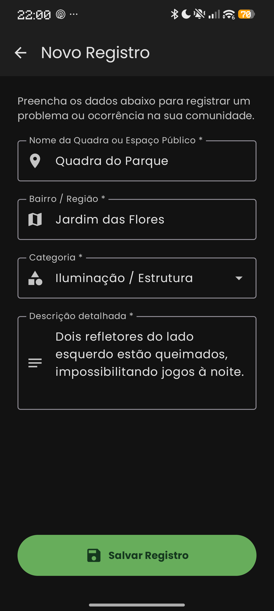
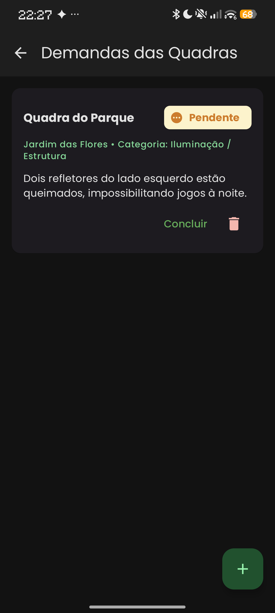
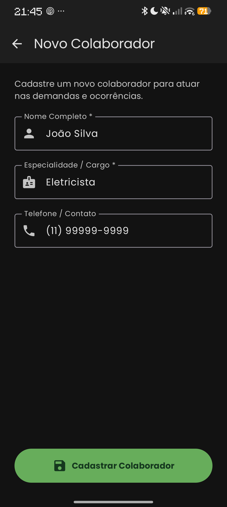
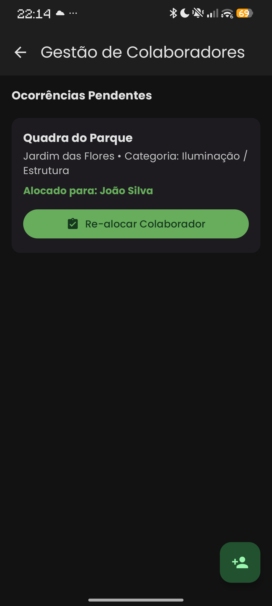
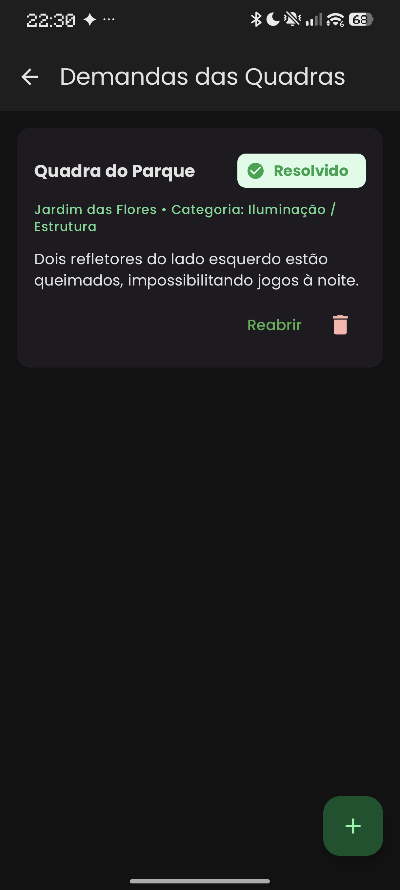

# Arena Cidadã — Gestão e Zeladoria de Espaços Esportivos Públicos

Aplicativo Android desenvolvido para a **Global Solution 2026 (Desafio CitizenTech)** na disciplina de **Android Kotlin Developer** (FIAP).

## Integrantes da Equipe
- **Nome Completo:** Matheus Rocha Sousa — **RM:** 559201
- **Nome Completo:** Luciano Henrique Gonçalves D'Oliveira — **RM:** 558975

---

## Problema e Público Beneficiado
Quadras e centros desportivos públicos sofrem frequentemente com problemas de manutenção (iluminação queimada, alambrados danificados, piso irregular) e com a falta de um canal simples para a comunidade registar ocorrências e acompanhar a resolução das demandas.

O **Arena Cidadã** beneficia diretamente **moradores locais, atletas amadores de fim de semana, líderes comunitários e zeladores**, permitindo registar solicitações por espaço desportivo, acompanhar prioridades e atualizar o estado de cada ocorrência.

---

## Conexão com os ODS da ONU (Agenda 2030)
- **ODS 3 — Saúde e Bem-Estar:** Ao facilitar a conservação de quadras e espaços públicos de lazer, a solução incentiva a prática regular de atividades físicas e o convívio saudável na comunidade.
- **ODS 11 — Cidades e Comunidades Sustentáveis:** Promove a zeladoria participativa e o acesso seguro, inclusivo e democrático aos espaços públicos urbanos.

---

## Funcionalidades Implementadas
1. **Tela Inicial (`StartScreen`):** Tela de boas-vindas com dois grandes blocos/atalhos interativos para acesso aos módulos de acompanhamento de demandas e gestão de colaboradores.
2. **Dashboard (`HomeScreen`):** Apresentação da proposta CitizenTech e resumo em tempo real do total de registos e de demandas atendidas.
3. **Listagem e Acompanhamento (`DemandListScreen`):**
   - Exibição dos registos em `LazyColumn` com indicação clara de estado vazio (*empty state*) e chips semânticos de cores.
   - **Ação adicional 1 (Alteração de Estado):** Alternar entre *Pendente* e *Resolvido* diretamente no registo.
   - **Ação adicional 2 (Exclusão):** Remover demandas da base de dados local.
4. **Cadastro de Demandas (`DemandFormScreen`):**
   - Formulário completo para inserção do nome da quadra, bairro, menu dropdown interativo para categoria e campo de texto de múltiplas linhas para a descrição.
   - Validação de campos obrigatórios impedindo o registo de dados em branco.
5. **Módulo de Colaboradores (`ColaboradoresScreen` & `ColaboradorFormScreen`):**
   - Registo no banco de dados de novos colaboradores (com Nome, Especialidade e Telefone).
   - Listagem interativa que filtra e exibe apenas as ocorrências *Pendentes*.
   - **Ação adicional 3 (Alocação Dinâmica):** Opção de atribuir um colaborador cadastrado (por meio de *Dialog* com lista suspensa) a uma demanda pendente, registando o responsável diretamente na tarefa.
6. **Persistência Local (`Room`):** Toda a base de dados (Demandas e Colaboradores) permanece guardada no dispositivo e relacionada.
7. **Identidade Visual e UI/UX:** Tema em Dark Mode nativo com cores primárias (Verde Esmeralda e Azul), com a tipografia global customizada (Google Font *Poppins*) incorporada no APK.

---

## Tecnologias e Arquitetura Utilizadas
- **Linguagem:** Kotlin
- **Interface:** Jetpack Compose + Material 3
- **Identidade Visual:** UI/UX com Dark Theme nativo, fontes customizadas localmente e ícones vectoriais semânticos.
- **Navegação:** Navigation Compose (`NavHost` / `NavController`)
- **Gestão de Estado:** `ViewModel` + `StateFlow` (`collectAsStateWithLifecycle`)
- **Persistência Local:** Room Database (`@Entity`, `@Dao`, `@Database` com migrações, Coroutines e Kotlin Flow)

### Estrutura de Pacotes (`mrsmatheusrocha.com.github.arenacidada`)
- `data/`: Entidades (`CourtDemandEntity`, `ColaboradorEntity`), DAOs correspondentes e `AppDatabase` com versão atualizada.
- `viewmodel/`: `ArenaViewModel` gerindo estados simultâneos de colaboradores e demandas, e `ArenaViewModelFactory`.
- `ui/`: Múltiplas telas (incluindo `StartScreen`, `ColaboradoresScreen`, `ColaboradorFormScreen`) e centralizador de navegação (`ArenaCidadaApp`).
- `ui/theme/`: Configuração avançada de tipografia e esquemas de cores.

---

## Como Funciona o App (Manual de Uso e Demonstração)

Abaixo estão detalhados os principais fluxos de uso do **Arena Cidadã**, guiando o usuário passo a passo. O sistema foi desenvolvido para ser extremamente intuitivo e garantir que nenhum dado seja perdido, graças à persistência com o Room Database.

### 1. Início e Dashboard de Demandas

Assim que o aplicativo é iniciado e carrega os dados salvos localmente (evidência de persistência), o usuário se depara com a **Tela de Boas-vindas (`StartScreen`)**. Nela, há duas opções principais:

*   **Acompanhar Demandas:** Para gerenciar e registrar problemas nas quadras.
*   **Gestão de Colaboradores:** Para registrar equipes e alocá-las aos serviços.

Ao tocar em **Acompanhar Demandas**, o usuário visualiza o **Dashboard principal**. Nele, estão os indicadores com estatísticas em tempo real, informando o total de chamados abertos pela comunidade e quantos já foram atendidos. 

 &nbsp; &nbsp; 

### 2. Registrar Ocorrência e Listagem

Na tela de Dashboard, se o usuário quiser reportar um novo problema, ele clica em **"Registrar Nova Ocorrência"**. 
*   O app exibe um formulário validado, impedindo o envio de informações incompletas. 
*   Ele conta com um **Menu Dropdown** para categorias, evitando erros de digitação.

Ao salvar e voltar ao menu, clicando em **"Acompanhar Quadras e Demandas"**, o usuário cai na tela de Listagem.
*   As demandas aparecem em cartões bem estruturados.
*   O status visual é claro: **Laranja** para Pendente, **Verde** para Resolvido.

 &nbsp; &nbsp; 
   
### 3. Gestão e Alocação de Colaboradores

Retornando à tela inicial de boas-vindas e entrando em **"Gestão de Colaboradores"**:
*   O usuário pode cadastrar um novo trabalhador/voluntário (nome, especialidade, telefone) usando o botão flutuante, que exibe um alerta de sucesso ao concluir.
*   A tela principal de gestão automaticamente filtra as demandas das quadras que **estão pendentes**.
*   Clicando no botão **"Alocar Colaborador"** em uma demanda, o app abre um diálogo de seleção com a lista de colaboradores recém-cadastrados.
*   Ao selecionar o colaborador e confirmar, a demanda fica amarrada àquele profissional, e essa informação (ex: *"Alocado para: João"*) aparecerá em destaque na lista para facilitar o acompanhamento.

 &nbsp; &nbsp; 

### 4. Resolução da Demanda

De volta à lista de demandas (pela primeira opção da tela inicial), o usuário visualiza o status final atualizado e pode concluir a gestão do chamado.
*   Após o colaborador terminar o serviço, basta clicar em **"Concluir"**. A demanda fica verde e a contagem no dashboard principal é atualizada em tempo real.
*   Quando resolvida, a demanda some da fila de ocorrências pendentes na tela de Gestão de Colaboradores.
*   É possível reabrir a demanda caso o problema retorne, ou excluí-la de forma definitiva usando o ícone da lixeira (apagando do Room DB de vez).

 &nbsp; &nbsp; 

---

## Instruções para Executar o Projeto
1. Descompacte o ficheiro `.zip` e abra a pasta `gs2-kotlin-main` no **Android Studio (Ladybug ou superior)**.
2. Aguarde a sincronização automática do Gradle (`Gradle Sync`).
3. Selecione um emulador ou dispositivo físico com **Android 8.0 (API 26)** ou superior.
4. Clique em **Run ('app')**.
