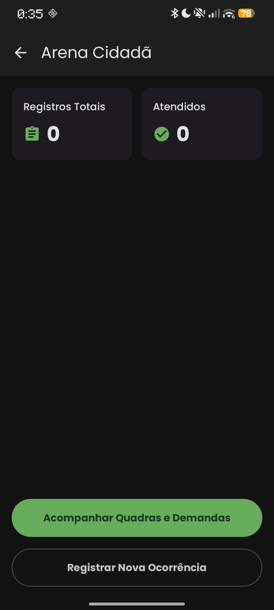
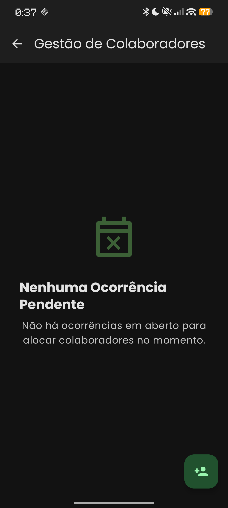
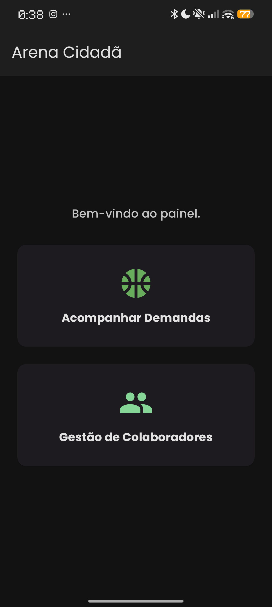

# Arena Cidadã — Gestão e Zeladoria de Espaços Esportivos Públicos

Aplicativo Android desenvolvido para a **Global Solution 2026 (Desafio CitizenTech)** na disciplina de **Android Kotlin Developer** (FIAP).

## Integrantes da Equipe
- **Nome Completo:** Matheus Rocha Sousa — **RM:** 559201
- **Nome Completo:** Luciano Henrique Gonçalves D'Oliveira — **RM:** 558975

---

## Problema e Público Beneficiado
Quadras e centros desportivos públicos sofrem frequentemente com problemas de manutenção (iluminação queimada, alambrados danificados, piso irregular) e com a falta de um canal simples para a comunidade registar ocorrências e acompanhar a resolução das demandas.

O **Arena Cidadã** beneficia diretamente **moradores locais, atletas amadores de fim de semana, líderes comunitários e zeladores**, permitindo registar solicitações por espaço desportivo, acompanhar prioridades e atualizar o estado de cada ocorrência.

---

## Conexão com os ODS da ONU (Agenda 2030)
- **ODS 3 — Saúde e Bem-Estar:** Ao facilitar a conservação de quadras e espaços públicos de lazer, a solução incentiva a prática regular de atividades físicas e o convívio saudável na comunidade.
- **ODS 11 — Cidades e Comunidades Sustentáveis:** Promove a zeladoria participativa e o acesso seguro, inclusivo e democrático aos espaços públicos urbanos.

---

## Funcionalidades Implementadas
1. **Tela Inicial (`StartScreen`):** Tela de boas-vindas com dois grandes blocos/atalhos interativos para acesso aos módulos de acompanhamento de demandas e gestão de colaboradores.
2. **Dashboard (`HomeScreen`):** Apresentação da proposta CitizenTech e resumo em tempo real do total de registos e de demandas atendidas.
3. **Listagem e Acompanhamento (`DemandListScreen`):**
   - Exibição dos registos em `LazyColumn` com indicação clara de estado vazio (*empty state*) e chips semânticos de cores.
   - **Ação adicional 1 (Alteração de Estado):** Alternar entre *Pendente* e *Resolvido* diretamente no registo.
   - **Ação adicional 2 (Exclusão):** Remover demandas da base de dados local.
4. **Cadastro de Demandas (`DemandFormScreen`):**
   - Formulário completo para inserção do nome da quadra, bairro, menu dropdown interativo para categoria e campo de texto de múltiplas linhas para a descrição.
   - Validação de campos obrigatórios impedindo o registo de dados em branco.
5. **Módulo de Colaboradores (`ColaboradoresScreen` & `ColaboradorFormScreen`):**
   - Registo no banco de dados de novos colaboradores (com Nome, Especialidade e Telefone).
   - Listagem interativa que filtra e exibe apenas as ocorrências *Pendentes*.
   - **Ação adicional 3 (Alocação Dinâmica):** Opção de atribuir um colaborador cadastrado (por meio de *Dialog* com lista suspensa) a uma demanda pendente, registando o responsável diretamente na tarefa.
6. **Persistência Local (`Room`):** Toda a base de dados (Demandas e Colaboradores) permanece guardada no dispositivo e relacionada.
7. **Identidade Visual e UI/UX:** Tema em Dark Mode nativo com cores primárias (Verde Esmeralda e Azul), com a tipografia global customizada (Google Font *Poppins*) incorporada no APK.

---

## Tecnologias e Arquitetura Utilizadas
- **Linguagem:** Kotlin
- **Interface:** Jetpack Compose + Material 3
- **Identidade Visual:** UI/UX com Dark Theme nativo, fontes customizadas localmente e ícones vectoriais semânticos.
- **Navegação:** Navigation Compose (`NavHost` / `NavController`)
- **Gestão de Estado:** `ViewModel` + `StateFlow` (`collectAsStateWithLifecycle`)
- **Persistência Local:** Room Database (`@Entity`, `@Dao`, `@Database` com migrações, Coroutines e Kotlin Flow)

### Estrutura de Pacotes (`mrsmatheusrocha.com.github.arenacidada`)
- `data/`: Entidades (`CourtDemandEntity`, `ColaboradorEntity`), DAOs correspondentes e `AppDatabase` com versão atualizada.
- `viewmodel/`: `ArenaViewModel` gerindo estados simultâneos de colaboradores e demandas, e `ArenaViewModelFactory`.
- `ui/`: Múltiplas telas (incluindo `StartScreen`, `ColaboradoresScreen`, `ColaboradorFormScreen`) e centralizador de navegação (`ArenaCidadaApp`).
- `ui/theme/`: Configuração avançada de tipografia e esquemas de cores.

---

## Como Funciona o App (Manual de Uso e Demonstração)

Abaixo estão detalhados os principais fluxos de uso do **Arena Cidadã**, ilustrados com as capturas de tela do aplicativo em funcionamento.

### 1. Acesso Inicial e Dashboard
Ao abrir o app, o usuário é recebido pela **Tela de Boas-vindas**, que centraliza a navegação em dois grandes módulos: **Acompanhar Demandas** (focado na infraestrutura das quadras) e **Gestão de Colaboradores** (focado na mão de obra).
Acessando o painel de demandas, o usuário visualiza o **Dashboard principal**, onde constam cards informativos com o número exato de solicitações totais e solicitações já resolvidas na comunidade, lidas em tempo real do banco de dados local.

### 2. Cadastro de Ocorrências (Quadras)
Ao tocar em "Registrar Nova Ocorrência", o app exibe um formulário padronizado. Para evitar dados inconsistentes, o formulário conta com:
- **Ícones semânticos** em todos os campos.
- **Menu Dropdown** (lista suspensa) limitando a Categoria a opções válidas (ex: Iluminação, Alambrado, Limpeza).
- **Validação de preenchimento:** O app emite um aviso vermelho caso o usuário tente salvar a demanda com campos obrigatórios em branco.

### 3. Listagem Inteligente e Atualização de Status
Todas as ocorrências registradas vão para a tela de **Demandas das Quadras**.
- **Empty State:** Se não houver registros, o app exibe uma ilustração convidativa.
- **Chips Coloridos:** Na listagem, as demandas pendentes são marcadas em **Laranja**, enquanto as já resolvidas ficam destacadas em **Verde**, facilitando a triagem visual.
- **Gestão Ágil:** O usuário pode alternar o status do chamado ("Concluir" ou "Reabrir") ou excluir a demanda permanentemente usando os botões inferiores no próprio card.

   
### 4. Módulo de Colaboradores e Alocação de Pessoal
Este módulo resolve o desafio de direcionar mão de obra para os chamados:
- Pelo botão flutuante, o usuário cadastra o **Nome, Cargo e Telefone** de voluntários ou trabalhadores da zeladoria.
- A tela principal deste módulo **filtra automaticamente** e exibe apenas as demandas das quadras que estão **Pendentes**.
- Ao clicar em **"Alocar Colaborador"**, um *Dialog* aparece listando as pessoas cadastradas. O usuário escolhe um responsável por meio do *radio button*, e a demanda é instantaneamente atualizada com o nome de quem irá realizar o serviço.

### 5. Banco de Dados Local (Persistência com Room)
Graças à arquitetura robusta com **Room Database, Coroutines e ViewModel**, o aplicativo não perde nenhuma informação. Todas as quadras inseridas, colaborações alocadas e exclusões são salvas permanentemente no aparelho.

---

## Instruções para Executar o Projeto
1. Descompacte o ficheiro `.zip` e abra a pasta `gs2-kotlin-main` no **Android Studio (Ladybug ou superior)**.
2. Aguarde a sincronização automática do Gradle (`Gradle Sync`).
3. Selecione um emulador ou dispositivo físico com **Android 8.0 (API 26)** ou superior.
4. Clique em **Run ('app')**.
